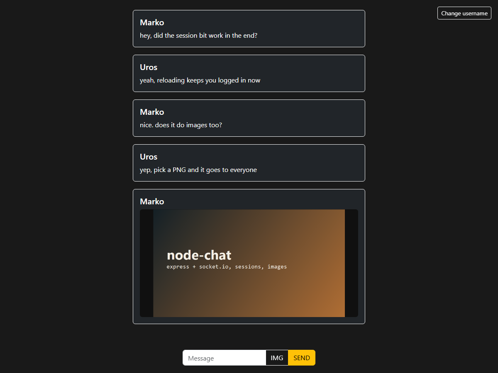

# node-chat

A small real-time chat: pick a username, everyone sees your messages instantly, and you can drop images into the room. Express + Socket.IO, session-based usernames, no database — the room lives only while the server runs.

I wrote it as a school project, mostly to get comfortable with Express and Socket.IO.



## Run

```bash
npm install
cp .env.example .env     # then edit the values if you want
npm start                # http://localhost:3000
```

## How it works

- **Usernames** live in an `express-session` cookie. Socket.IO shares the same session (`io.engine.use(sessionMiddleware)`), so a socket knows who you are without a token.
- **Messages** are broadcast to everyone except the sender, stripped of HTML on the server, and capped at `MAX_MESSAGE_LENGTH` (300 by default).
- **Images** are sent as data URLs, limited to ~2 MB and only `png`/`jpeg`/`gif`/`webp`.
- **No persistence** — restarting the server clears the chat.

## Tests

```bash
npm test
```

The smoke test spawns the server on a spare port and checks: login redirects, session isolation between two users, message broadcast, HTML stripping, over-length rejection, and image validation (12 checks).

## Notes

Sessions use the default in-memory store, which is fine for a demo but leaks memory and doesn't survive a restart — swap in `connect-redis` or similar before running this for real. There is also no rate limiting yet, so one client could flood the room.
